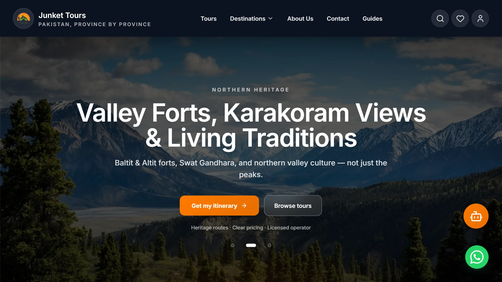
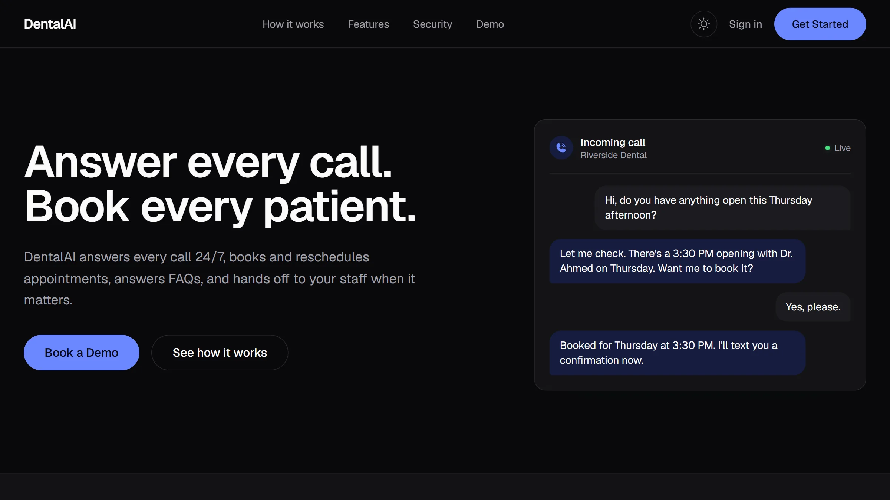

<div align="center">

# Aadil Salman Butt

### I ship full-stack products with AI built in.

Full Stack Engineer in Lahore, Pakistan. Booking platforms, voice receptionists, research agents and payment systems, built across Next.js, Node and Python.

**[Visit the portfolio](https://aadilsalmanportfolio.vercel.app)** · **[Download my résumé](public/resume.pdf)** · **[Email me](mailto:aadilsalman786@gmail.com)** · **[LinkedIn](https://www.linkedin.com/in/aadilsalman)** · **[WhatsApp](https://wa.me/923035116528)**

🟢 Open to full-stack and AI roles, remote or Lahore. Also open to focused contract builds.

</div>

---

## At a glance

| | |
|---|---|
| **3** | payment gateways integrated in production: Stripe, Chase and KuickPay |
| **3** | of my builds are deployed for you to open and try |
| **2023** | the year I started writing production code, as an intern |
| **BS CS** | FAST-NUCES Lahore, class of 2026, finished while working full time |

---

## Selected work

### 01 · Junket Tours: a tour booking platform for adventure travel in Pakistan

Client build · **[Live site](https://touragency-wheat.vercel.app)** · [Case study](https://aadilsalmanportfolio.vercel.app/work/junket-tours)



- Guests book a tour without creating an account.
- Staff run tours, bookings, users and the blog from one realtime admin panel.
- An AI trip planner builds itineraries only from tours that are in the catalog.

`Next.js 14` `Convex` `Groq` `Resend` `Tailwind CSS`

### 02 · DentalAI Receptionist: an AI receptionist for dental clinics

My own product, pre-launch · **[Product site](https://voice-receptionist-dentail.vercel.app)** · [Case study](https://aadilsalmanportfolio.vercel.app/work/dentalai-receptionist)



- Books, reschedules and cancels against Google Calendar during the call.
- Hands emergencies, billing disputes and clinical questions to staff.
- Writes a summary of every call to a multi-tenant clinic dashboard.

`Vapi` `Convex` `Next.js` `Google Calendar` `n8n` `Claude API`

### 03 · ApexFlow: Formula 1 lap-time predictions that retrain every race week

Personal project · [Code](https://github.com/aadilsal/ApexFlow) · [Case study](https://aadilsalmanportfolio.vercel.app/work/apexflow)

- Airflow retrains weekly on new race data and promotes a model only if it beats the current one.
- A FastAPI service returns each prediction with an uncertainty estimate.
- Prometheus and Grafana watch accuracy and data drift.

`Python` `XGBoost` `Airflow` `MLflow` `FastAPI` `Docker`

### More work

| Project | What it does | Stack |
|---|---|---|
| [ResearchOS](https://research-os-taupe.vercel.app) | Four AI agents plan, search, read and write a research report while you watch the progress live. | Next.js 14 · Convex · LangGraph · Clerk |
| [InsightOS](https://github.com/aadilsal/Insight-OS) | Ask a question in plain English and get a read-only SQL query and a finance-style summary back. | TypeScript · SQL · LLM |
| [Churn Predictor](https://github.com/aadilsal/Churn-Predictor) | Churn risk scores with the reasons behind each one, served over an API with a dashboard. | XGBoost · SHAP · FastAPI · Streamlit |
| [FairPlay Review System](https://github.com/aadilsal/FairPlayReviewSystem) | Computer vision for cricket reviews: ball tracking, batsman tracking, wicket detection and pose estimation. | Python · Computer vision |
| [JobFinder](https://github.com/aadilsal/JobFinder) | Scans 15 job sources, scores each role against a CV and drafts the application for the ones worth sending. | Python · Claude API |
| [SaaS Starter](https://github.com/aadilsal/Next.js-Supabase-SaaS-Boilerplate-with-Stripe-Auth) | A Next.js starter with auth, Stripe subscriptions, teams, emails and an admin panel already wired up. | TypeScript · Supabase · Stripe |

---

## Experience

**Full Stack Engineer, Ilmversity** · Oct 2025 to now · Lahore
*A multi-tenant school management platform.*

- Integrated Stripe, Chase and KuickPay into three payment flows, cutting failed payments by about 25%.
- Built an LLM chatbot and a voice assistant that now handle about 40% of support questions without a person.
- Cut page load time by about 35% with frontend optimisation and API caching.
- Built a shared library of 15+ React components that the team reuses across features.

**Web Development Intern, Fiveriver Technologies** · Jul 2023 to Mar 2024

- Shipped responsive React features against a MongoDB-backed API.
- Refactored legacy code and added unit tests, cutting bug tickets by about 20%.

---

## What I know, and how well

**Production:** shipped at work or to real users. **Proficient:** several finished projects. **Working:** one project or coursework.

| Area | Production | Proficient | Working |
|---|---|---|---|
| **Frontend** | TypeScript, React, Next.js App Router, JavaScript, Tailwind / shadcn/ui | Vitest | |
| **Backend and data** | Node.js and REST APIs, payment gateways, Convex | Python / FastAPI, SQL, MongoDB | C# / ASP.NET |
| **AI and machine learning** | LLM apps and agents | Classical ML, voice agents, RAG and vector search, MLOps, n8n automation | Computer vision |
| **Cloud and delivery** | Git and GitHub, Vercel | Docker, CI/CD | Monitoring, AWS |

---

## About me

I like owning a feature from the schema to the button. I finished my computer science degree at FAST-NUCES in 2026 while working full time, and I build my own products in the evenings.

Most of my recent work puts a language model somewhere in the path, with guardrails so it stays useful: read-only SQL, answers limited to a catalog, a human handoff when a call gets clinical.

- **Education:** BS Computer Science, FAST-NUCES Lahore, 2022 to 2026
- **Certificates:** AWS Academy Cloud Foundations; Digital Skills: Artificial Intelligence, FutureLearn
- **Based in:** Lahore, Pakistan, UTC+5

---

<div align="center">

## Hiring for a full-stack or AI role? Let's talk.

Email and WhatsApp are the quickest ways to reach me.

**[aadilsalman786@gmail.com](mailto:aadilsalman786@gmail.com)** · **[WhatsApp](https://wa.me/923035116528)** · **[LinkedIn](https://www.linkedin.com/in/aadilsalman)** · **[GitHub](https://github.com/aadilsal)** · **[Résumé, PDF](public/resume.pdf)**

</div>

---

<details>
<summary><b>About this repo</b>: how the portfolio site is built</summary>

The site at [aadilsalmanportfolio.vercel.app](https://aadilsalmanportfolio.vercel.app) is a Next.js 14 App Router project with TypeScript and Tailwind CSS. A Groq-backed assistant in the hero answers questions about my work and cites where each answer comes from. Its prompt is built from the same data files the site renders, so the two can't drift apart.

**Content lives in data, not components**

| File | What it holds |
|------|---------------|
| `data/resume.json` | Hero copy, proof strip, experience, about, education, contact |
| `data/projects.ts` | Flagship projects with their case studies, plus the "More work" cards |
| `data/skills.ts` | Skill rows: level, tier and proof |
| `public/work/<slug>/*.webp` | Screenshots |
| `public/resume.pdf` | The downloadable résumé |

**Run it locally**

```bash
npm install
cp .env.example .env.local   # add GROQ_API_KEY
npm run dev
```

| Variable | Required | Purpose |
|----------|----------|---------|
| `GROQ_API_KEY` | For the assistant | Groq key for `/api/chat` |
| `GROQ_MODEL` | No | Override the default `openai/gpt-oss-120b` |
| `NEXT_PUBLIC_SITE_URL` | No | Canonical address; defaults to `siteUrl` in `data/resume.json` |

Motion uses CSS for everything except the screenshot tilt and the skills-stack lean (Motion springs), plus `next-view-transitions` for the screenshot morph into a case study. All of it respects `prefers-reduced-motion`, and the content stays visible with JavaScript off.

</details>
